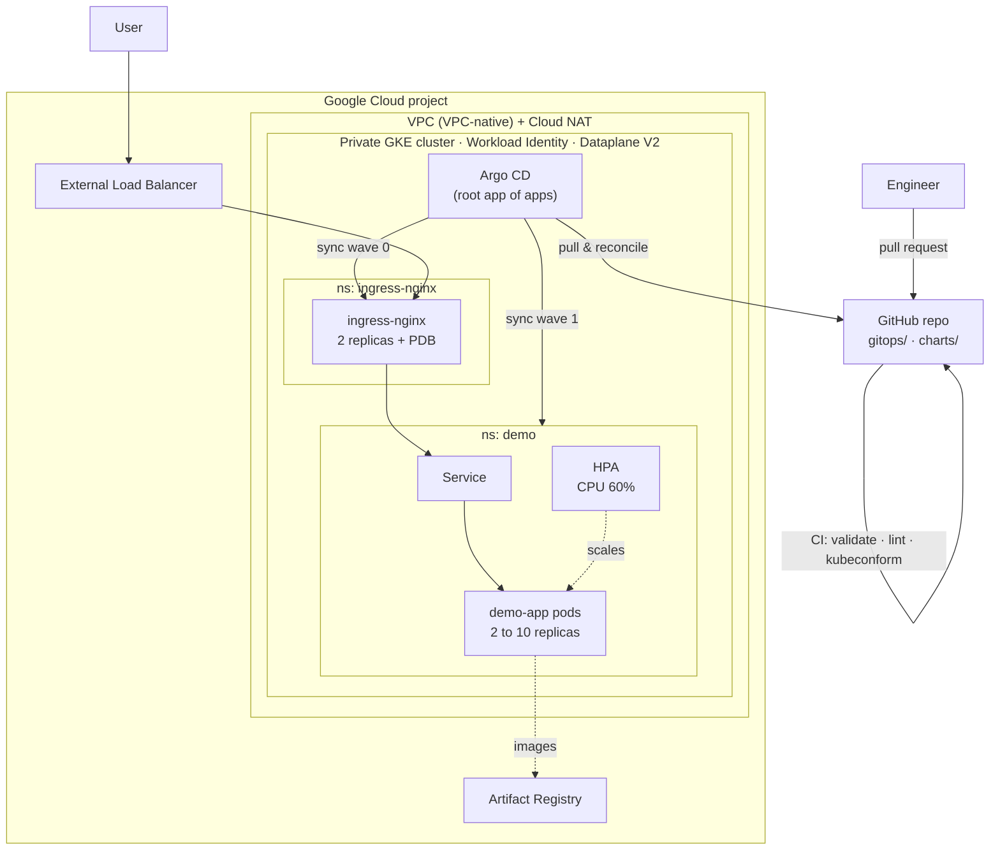
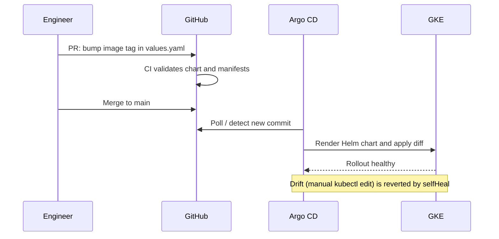

# GKE GitOps Platform

[](https://github.com/codewithgarry/gke-gitops-platform/actions/workflows/ci.yaml)


A GitOps platform on Google Kubernetes Engine. **Terraform** builds a private GKE cluster. **Argo CD** then keeps everything running on it in sync with this Git repository: the NGINX ingress controller and a sample app packaged as a **Helm** chart with autoscaling.

> Git is the single source of truth. Nobody runs `kubectl apply` against the cluster. A merged pull request *is* the deployment.

## ✨ Highlights

- **Private GKE cluster** with VPC-native networking, Cloud NAT, Workload Identity, Shielded nodes, Dataplane V2 and a least-privilege node service account.
- **App of apps** pattern. A single root Application bootstraps everything else, ordered with sync waves.
- **Self-healing.** Manual changes in the cluster are reverted automatically, and deleted resources are pruned.
- **Production-ready Helm chart** with HPA, PodDisruptionBudget, probes, topology spread and a hardened security context (non-root, read-only filesystem, all capabilities dropped).
- **CI** runs `terraform validate`, `helm lint` and **kubeconform** schema checks on every PR.

## 🏗️ Architecture



### Delivery flow



## 📁 Repository structure

```text
.
├── terraform/                  # VPC, Cloud NAT, private GKE, node pool, Artifact Registry
├── gitops/
│   ├── bootstrap/
│   │   ├── argocd-values.yaml  # Argo CD Helm values
│   │   └── root-app.yaml       # app of apps
│   └── apps/                   # one Argo CD Application per component
│       ├── ingress-nginx.yaml  # sync wave 0
│       └── demo-app.yaml       # sync wave 1
├── charts/demo-app/            # Helm chart: Deployment, Service, Ingress, HPA, PDB
├── scripts/
│   ├── bootstrap-argocd.sh     # install Argo CD and apply the root app
│   └── load-test.sh            # generate load to watch the HPA scale
└── .github/workflows/ci.yaml
```

## 🚀 Getting started

**Prerequisites:** a GCP project with billing, `gcloud`, `terraform` ≥ 1.6, `kubectl` and `helm`.

### 1. Provision the cluster

```bash
gcloud auth application-default login
gsutil mb -l asia-south1 gs://<project-id>-tfstate      # remote state bucket
gsutil versioning set on gs://<project-id>-tfstate

cd terraform
cp terraform.tfvars.example terraform.tfvars            # set project_id and your IP
terraform init -backend-config="bucket=<project-id>-tfstate"
terraform apply
```

### 2. Bootstrap GitOps

```bash
./scripts/bootstrap-argocd.sh <project-id>
```

From here on, Argo CD deploys everything in `gitops/apps/`. Open the UI:

```bash
kubectl -n argocd port-forward svc/argocd-server 8080:443
```

### 3. Reach the app

```bash
kubectl -n ingress-nginx get svc ingress-nginx-controller   # EXTERNAL-IP
curl http://<EXTERNAL-IP>/
```

### 4. Watch autoscaling

```bash
kubectl -n demo get hpa,pods -w      # terminal 1
./scripts/load-test.sh               # terminal 2
```

### 5. Ship a change the GitOps way

Edit `charts/demo-app/values.yaml`, for example `image.tag: "1.0"`. Open a PR and merge it. Argo CD rolls it out with zero downtime, because of `maxUnavailable: 0` and the PDB.

### Clean up

```bash
cd terraform && terraform destroy
```

## 🔐 Design decisions

| Decision | Why |
|---|---|
| Private nodes + Cloud NAT | Nodes have no public IPs. Egress still works for images and charts |
| Master authorized networks | The API server is reachable only from approved CIDRs |
| Dedicated node service account | The default compute SA has Editor, far too broad |
| Workload Identity | Pods get GCP access without exported keys |
| `ignoreDifferences` on replicas | The HPA owns replica count, so Argo CD must not fight it |
| No CPU limits, memory limits set | Avoids CPU throttling while still protecting nodes from memory leaks |
| `maxUnavailable: 0` + PDB | Rollouts and node upgrades never drop below serving capacity |

## 🧠 What I learned

- **Bootstrap once, then let Git drive.** Only Argo CD itself is installed imperatively. Everything after that, including the ingress controller, is declared in Git. Rebuilding a cluster becomes one script plus a sync.
- **Sync waves matter.** Without ordering, the app's Ingress can be applied before the ingress controller exists. Waves make the dependency explicit.
- **GitOps and HPA conflict by default.** A Deployment with a fixed `replicas` keeps getting reset by Argo CD while the HPA scales it. Dropping `replicas` from the template when autoscaling is on, plus `ignoreDifferences`, fixes it.
- **Self-heal changes incident habits.** A hot-fix with `kubectl edit` is reverted within minutes. Emergency changes still have to go through Git, which keeps the audit trail honest.
- **Validate before the cluster sees it.** `helm lint` misses schema errors such as wrong `apiVersion` or typos in fields. Rendering the chart and running kubeconform in CI catches them on the PR.

## 🛣️ Roadmap

- [ ] cert-manager + Let's Encrypt TLS for the ingress
- [ ] Argo CD `AppProject` with restricted source repos and namespaces
- [ ] Image updates via Argo CD Image Updater or a CI tag-bump PR
- [ ] Separate dev and prod overlays with ApplicationSets
- [ ] Prometheus monitoring (see [k8s-observability-sre-kit](https://github.com/codewithgarry/k8s-observability-sre-kit))

## 👤 Author

**Girish Sharma** · Cloud & DevOps Engineer · CKA · Google Cloud Professional Cloud Architect
[GitHub](https://github.com/codewithgarry) · [LinkedIn](https://www.linkedin.com/in/codewithgarry/)
